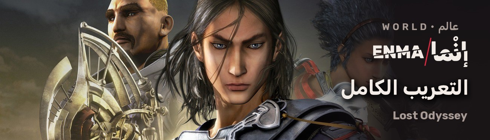
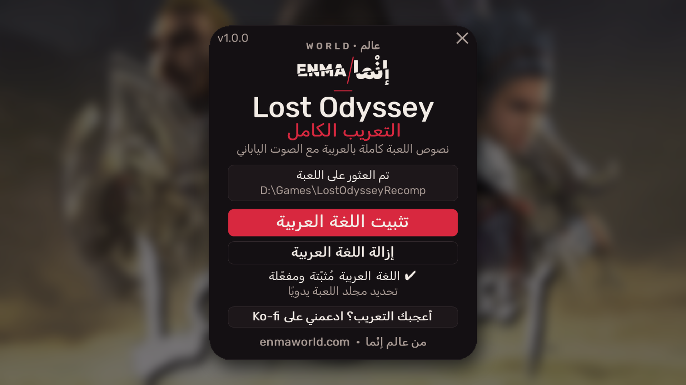

<h1 align="center">Lost Odyssey — التعريب الكامل</h1>

Complete Arabic localization for <b>Lost Odyssey</b> on <a href="https://github.com/freefrank/LostOdysseyRecomp">LostOdysseyRecomp</a> · تعريب كامل للعبة

  <a href="https://github.com/faisalkindi/LostOdyssey-Arabic/releases/latest/download/LostOdyssey_Arabic_Installer.zip"><b>⬇ تحميل المثبّت / Download installer</b></a>
  &nbsp;·&nbsp;
  <a href="https://github.com/faisalkindi/LostOdyssey-Arabic/releases/latest/download/LostOdyssey_Arabic_Manual.zip">ملفات التثبيت اليدوي / Manual files</a>
  &nbsp;·&nbsp;
  <a href="https://github.com/faisalkindi/LostOdyssey-Arabic/releases">كل الإصدارات / All releases</a>
  &nbsp;·&nbsp;
  <a href="https://ko-fi.com/kindiboy">☕ Ko-fi</a>

---

## العربية

**ماذا يعرّب؟** نصوص اللعبة كلها، 28,530 سطرًا مترجمًا عن النص الياباني الأصلي: الحوارات، الترجمة أسفل المشاهد، القوائم، الأدوات والمهارات، رسائل المعارك، أحلام الألف عام، الإنجازات، وصور الشروح. الصوت ياباني.

**المميزات**
- العربية لغة جديدة في Settings ← System ← Game language، ولا تستبدل أي لغة.
- خط اليمامة مضاف إلى خطوط اللعبة نفسها، بحروف موصولة سليمة.
- النص من اليمين إلى اليسار مع بقاء تصميم الشاشات كما هو.
- صور الشروح بالعربية بدل اليابانية.
- لا يُعدَّل أي ملف من ملفات اللعبة الأصلية، والإزالة بنقرة واحدة.

**المتطلبات**
- [LostOdysseyRecomp](https://github.com/freefrank/LostOdysseyRecomp/releases) الإصدار v1.0.5 أو أحدث، مع ملفات لعبتك مستوردة وتعمل.

**التثبيت (المثبّت)**
1. أغلق اللعبة.
2. حمّل `LostOdyssey_Arabic_Installer.zip` من الرابط أعلاه وفكّ الضغط.
3. شغّل `Lost Odyssey Arabic Installer.exe`، فيجد مجلد اللعبة تلقائيًا (أو حدّده يدويًا)، ثم اضغط «تثبيت اللغة العربية».
4. شغّل اللعبة؛ العربية مختارة مسبقًا.

**التثبيت اليدوي**: فكّ `LostOdyssey_Arabic_Manual.zip` وانسخ المجلد `mods` إلى مجلد اللعبة (الذي فيه `LostOdysseyRecomp.exe`)، ثم اختر «العربية» من Settings ← System ← Game language واحفظ وأعد التشغيل. إن كانت عندك حزمة الصور عالية الدقة فانقل `ar-images` فوقها في Settings ← System ← Mods.

**الإزالة**: المثبّت ← «إزالة اللغة العربية»، أو احذف المجلدين `mods\ar` و`mods\ar-images`.

## English

**What it covers.** All of the game's text, 28,530 lines translated from the original Japanese script: dialogue, subtitles, menus, items and skills, battle messages, the Thousand Years of Dreams, achievements and the tutorial pictures. Voices stay Japanese.

**Features**
- Arabic is a new choice in Settings → System → Game language; no language is replaced.
- The Alyamama font is added to the game's own fonts, with properly joined letters.
- Right-to-left text, with every screen keeping its original layout.
- Tutorial pictures in Arabic instead of Japanese.
- No original game file is modified. One-click uninstall.

**Requirements**
- [LostOdysseyRecomp](https://github.com/freefrank/LostOdysseyRecomp/releases) v1.0.5 or newer, with your game files imported and working.

**Install (installer)**
1. Close the game.
2. Download `LostOdyssey_Arabic_Installer.zip` above and unzip it.
3. Run `Lost Odyssey Arabic Installer.exe`; it finds the game folder automatically (or pick it), then click the red install button.
4. Start the game; Arabic is already selected.

**Manual install**: unzip `LostOdyssey_Arabic_Manual.zip`, copy its `mods` folder into the folder that holds `LostOdysseyRecomp.exe`, then choose «العربية» in Settings → System → Game language, save and restart. With the HD texture pack, move `ar-images` above it in Settings → System → Mods.

**Uninstall**: installer → uninstall button, or delete `mods\ar` and `mods\ar-images`.

## Screenshots

## Notes

- The pack is built on the Japanese version of the game, so the game language underneath is Japanese.
- Font: [Alyamama](https://github.com/Mestaratype/AlYamama), SIL Open Font License 1.1; the licence ships with the download.
- Report any typo, clipped line or mistranslation in [Issues](https://github.com/faisalkindi/LostOdyssey-Arabic/issues).

من عالم إنْما · <a href="https://enmaworld.com">enmaworld.com</a>

